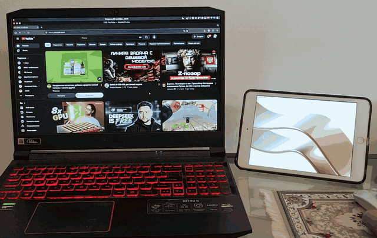

# Connector

**Turn an old iPad into a second monitor for Linux — over the cable, Wi-Fi or the internet.**

[Русская версия](README.ru.md)



Something like Duet Display or spacedesk, for Linux (X11) and iPads that can't run modern apps:
the app targets **iOS 12**, so an iPad mini 2/3, iPad Air or newer works. The iPad is a real
monitor to the desktop: you drag windows onto it, maximize them there, and arrange it in the
display settings.

- **Low latency:** H.264 via NVENC, VA-API (Intel/AMD) or x264, hardware decoding on the iPad, unchanged frames skipped
- **Cable, Wi-Fi or the internet:** USB through usbmuxd. The network uses TLS with a key paired over
  the cable, finds the computer on the local network by itself, and the cable takes over when plugged in
- **Touch or trackpad:** tap to click, drag, right/middle click, two-finger scroll; or move the pointer like on a laptop trackpad
- **Keyboard:** the on-screen keyboard (with Esc, Tab, Ctrl, Alt, arrows…) or a hardware one with shortcuts;
  any language, whatever the computer's layout
- **Second monitor or mirror** of the computer's screen, text size 100–200%, auto rotation
- **Free Apple ID friendly:** the app reminds you (on the iPad and the computer) before its 7-day signature runs out

```
 desktop ──► spare HDMI/DP port forced "connected" = a virtual monitor
                │  XShm capture + cursor (XFixes), unchanged frames skipped
                ▼
         connector-host ── H.264 (NVENC p1/ull, no B-frames) ─┬─► usbmuxd ─► USB ────────► iPad
                ▲                                             └─◄ TCP 27183, TLS-PSK ◄─ Wi-Fi / internet
                └──────── XTest (mouse, keyboard) ◄──── touches, keys ◄─────────────────────┘
                                                Connector.app: AVSampleBufferDisplayLayer
```

## Status

Works daily on one setup: Linux Mint 22 (Cinnamon, X11), a laptop with Intel + NVIDIA graphics,
iPad mini 2 on iOS 12.5.8. Other setups should work if they meet the requirements below,
but haven't been tried. Reports and pull requests are welcome.

## Compatibility

**Linux:** any distribution, as long as the desktop session is **X11**:

| Works (X11) | Doesn't work yet (Wayland) |
|---|---|
| Linux Mint (Cinnamon, MATE, Xfce) | Ubuntu 22.04+ by default (pick "Ubuntu on Xorg" at login instead) |
| Debian, Ubuntu, Arch, Manjaro… with Xfce, MATE, Cinnamon, i3… | Fedora 40+ (GNOME, KDE) |
| KDE Plasma with the X11 session | Pop!_OS 24.04 (COSMIC) |

**GPU:** the virtual monitor needs a spare HDMI/DP port on an Intel or AMD GPU (see below).
Encoding uses NVENC on NVIDIA, VA-API on Intel/AMD, or x264 on the CPU, whichever works first.

**iPad:** any 64-bit iPad with iOS 12 or later; one build of the app runs on all of them.
Tested on an iPad mini 2 (iOS 12.5.8); the rest is expected from how iOS runs the app:

| iPads | Expected |
|---|---|
| iPad mini 2, 3, 4, 5 · iPad Air (1st gen), Air 2 · iPad (5th, 6th gen) · iPad Pro 9.7" | **best fit:** native resolution, pixel for pixel |
| iPad (7th–9th gen, 10.2") · iPad Air (3rd gen) · iPad Pro 10.5" · iPad Pro 12.9" (all) | works; iOS scales the app up from 1024×768, a little softer |
| iPad Pro 11" (all) · iPad Air (4th gen+) · iPad (10th gen+) · iPad mini (6th gen+) | works; scaled, with black bars (not 4:3) |
| iPad 1–4, iPad mini (1st gen) | not supported (32-bit, iOS 9–10 at most) |

- **iOS 14 and later:** the iPad may not find the computer on Wi-Fi by itself (iOS restricts broadcasts);
  enter the computer's local address under Settings → Internet address for now.
- **iOS 16 and later:** turn on Settings → Privacy & Security → Developer Mode, or apps signed with a
  free Apple ID don't open.

Native resolution on every model and Bonjour discovery for iOS 14+ are planned once they can be
tested on a newer iPad.

## Android?

Connector is for iPads. For Android tablets there are good options already, for example
[Orbiscreen](https://github.com/shadow-x78/orbiscreen) (an app, USB or Wi-Fi, X11 and Wayland, stylus)
and [Weylus](https://github.com/H-M-H/Weylus) (in the tablet's browser, touch and stylus).

## Requirements

- **Linux with X11** (see above)
- **A spare HDMI or DisplayPort port** on an Intel or AMD GPU (i915/xe/amdgpu/radeon/nouveau kernel driver).
  Nothing gets plugged into it: the kernel is told a monitor is there, which makes a virtual
  monitor the desktop treats like a real one. NVIDIA's proprietary driver can't do this,
  but on hybrid laptops the Intel/AMD side usually has a port
- Hardware encoding (NVENC or VA-API) is optional; without it the host uses x264 (more CPU)
- An iPad with iOS 12 or later and its Lightning/USB cable
- A free Apple ID to sign the app (no developer account needed)

## Install

### 1. The host (Linux)

**Debian, Ubuntu, Mint:** download `connector_*.deb` for your release from
[Releases](../../releases), then

```sh
sudo apt install ./connector_*.deb
sudo connector-setup        # lets your user switch the spare port, opens port 27183 in ufw
connector-autostart on      # start with the desktop session (off: connector-autostart off)
```

**From source** (any distribution; package names below are Debian's):

```sh
sudo apt install build-essential libx11-dev libxext-dev libxfixes-dev libxrandr-dev libxtst-dev \
    libavcodec-dev libavutil-dev libswscale-dev libusbmuxd-dev libssl-dev libxkbcommon-dev usbmuxd
make                        # then run from here: scripts/..., or: sudo make install (to /usr/local)
sudo scripts/install.sh     # lets your user switch the spare port, opens port 27183 in ufw
scripts/autostart on        # start with the desktop session (off: scripts/autostart off)
```

`make deb` builds the package for the release you're on. Commands below are given as in a
source checkout (`scripts/connector`); with the package they are `connector`, `connector-display`,
`connector-autostart`, `connector-ipad-install`, `connector-setup`, `connector-report`.

The spare port is detected on the first run and saved in `~/.config/connector/config`
(`CONNECTOR_OUTPUT` is the xrandr name, `CONNECTOR_DRM` the kernel one, as in `/sys/class/drm/card*-NAME`).
Edit that file if the guess is wrong. To check: `scripts/connector-display on`, and a new monitor
should appear in the display settings. `scripts/connector-display off` removes it.

### 2. The iPad app

The app is signed with your Apple ID and installed over the cable by
[Impactor](https://github.com/claration/Impactor)'s `plumesign`. The package and the
[Releases](../../releases) include the built `Connector.ipa`:

```sh
plumesign account login -u YOUR_APPLE_ID   # once; enter the 2FA code
connector-ipad-install                     # with the iPad plugged in and unlocked
# from a source checkout: IPA=~/Downloads/Connector.ipa scripts/ipad-install
```

Building the app yourself takes clang, lld and an iOS SDK (`make ipa`):

```sh
sudo apt install clang lld
git clone --depth 1 --filter=blob:none --sparse https://github.com/theos/sdks /tmp/sdks
git -C /tmp/sdks sparse-checkout set iPhoneOS12.4.sdk
mkdir -p .deps && mv /tmp/sdks/iPhoneOS12.4.sdk .deps/
scripts/ipad-install                       # builds, signs and installs
```

- On the iPad, trust the developer once: Settings → General → Device Management.
- The 2FA code: if no trusted device shows it, put the iPad in Airplane mode and get the code under
  Settings → [your name] → Password & Security → Get Verification Code.
- Impactor 2.7.0's login fails with `Plist error: Serde(... <html> ...)`; use a release with
  the fix from claration/Impactor#288. Put `plumesign` on your PATH or set `PLUMESIGN=/path/to/plumesign`.
- Each Apple ID needs its own bundle id: a unique one is made on the first install and kept
  in `~/.config/connector/bundle-id`, so later installs update the same app.
- **A free Apple ID signs for 7 days.** Run `scripts/ipad-install` again before it expires;
  the iPad and the computer remind you a day ahead.

### 3. Pair

Open Connector on the iPad with the cable plugged in. The monitor appears, and the iPad receives
the key for Wi-Fi (`~/.config/connector/key`). From now on, on the same Wi-Fi, just open the app.

## Use

The host waits in the background. Open Connector on the iPad (cable or same Wi-Fi) and the monitor
appears; close the app or unplug and it disappears after 10 s, with windows moving back.
Log: `~/.cache/connector.log`. In the foreground, without the service: `scripts/connector -v`.

### Gestures

| Gesture | Touch mode | Trackpad mode |
|---|---|---|
| tap | left click there | left click at the pointer |
| one finger moves | drag with the left button | moves the pointer |
| tap, then touch again and move | — | drag with the left button |
| hold ~0.5 s | right click | right click |
| two-finger tap / hold | right click / middle click | same |
| two fingers move | scroll | scroll |
| three-finger tap | settings | settings |
| four-finger tap | keyboard | keyboard |

### Keyboard

Tap with four fingers (or Settings → Keyboard). The bar above the on-screen keyboard has Esc, Tab,
Ctrl, Alt, Win (these stick for the next key), arrows, Home/End, PgUp/PgDn and Del. Text arrives
as typed, in any language, whatever layout the computer has on. A hardware keyboard works too
once the keyboard is open: arrows, Esc and shortcuts (Cmd acts as Ctrl).

### Settings (three-finger tap)

| Setting | |
|---|---|
| iPad screen | second monitor, or mirror the computer's own screen |
| Text and window size | 100% = native 2048×1536 (sharpest, smallest), up to 200% = 1024×768 |
| Sharpness | encoder quality (NVENC cq 22 / 16 / 12) |
| Orientation | auto / landscape / portrait; in portrait the monitor becomes vertical |
| Pointer | touch where you point, or trackpad |
| Indicator | link and frame rate in a corner |
| Wi-Fi and internet | which computer, how connected now, the internet address |

Text gets crisper with greyscale font antialiasing instead of RGB (subpixel colour fringes blur
because H.264 keeps colour at half resolution).

## Wi-Fi and the internet

**Same Wi-Fi:** nothing to set up. The app finds the computer with a UDP broadcast on port 27183 and
connects to TCP 27183. A guest network that isolates clients won't work.

**Over the internet** the computer must be reachable from outside, for example:

- port forwarding on the router: TCP 27183 → the computer, plus a dynamic DNS name. Not possible behind CGNAT.
- Tailscale Funnel (untested): `sudo tailscale funnel --bg --tcp 10000 tcp://localhost:27183`,
  address `yourmachine.your-tailnet.ts.net:10000`. Tailscale itself doesn't run on iOS 12.

Set the address on the computer (the iPad picks it up on the next cable connection):
`echo myhome.example.com:27183 > ~/.config/connector/address`, or type it on the iPad under
Settings → Internet address. The iPad tries: Wi-Fi discovery, the last Wi-Fi address, the internet address.

Traffic is TLS 1.2 with the pre-shared key (PSK-AES128-GCM-SHA256); without the key nobody can
connect. To unpair all iPads, delete `~/.config/connector/key`, restart the service and pair by cable again.

Peak bitrate: 80 Mbit/s by cable, 30 over Wi-Fi, 10 over the internet (`--lan-bitrate`,
`--internet-bitrate`; VA-API drivers that only do constant quality ignore it). When the network
can't keep up, the host skips frames instead of queueing them, so latency doesn't build up.
USB only: `--no-network`; network only: `--no-usb`; another port: `--listen-port`.

## Troubleshooting

- **No monitor appears:** `scripts/connector-display on` prints what's wrong; check
  `~/.config/connector/config` and `xrandr`.
- **"TLS handshake failed" in the log:** the iPad isn't paired with this computer. Connect it by cable once.
- **The iPad doesn't find the computer over Wi-Fi:** check the firewall (`sudo ufw status`, port 27183 tcp+udp)
  and that both are on the same network.
- **The app doesn't open:** its signature expired. Run `scripts/ipad-install`.
- **Anything else:** `connector-host --check` shows what works on this machine; see below for reporting.

## Reporting a problem

1. Run `connector-report` (from a source checkout: `scripts/report`). It writes a report to
   `~/connector-reports/` (in a source checkout: `reports/`):
   your system and GPU, a self-check (`connector-host --check`: X11, encoders, USB, port) and the log,
   which includes the iPad app's own log. Device ids, public IP addresses, your user and computer names and home path
   are taken out; read it through anyway.
2. If the iPad doesn't connect at all, its log stays on the iPad: three-finger tap → App log → Copy.
3. [Open an issue](../../issues/new/choose) and paste both.

## Layout

| Path | |
|---|---|
| `host/connector-host.c` | capture, encoding, transport, input (C) |
| `host/protocol.h` | the protocol shared with the iPad app |
| `ios/main.m`, `ios/Info.plist`, `ios/*.lproj` | the iPad app (Objective-C, iOS 12), English and Russian |
| `ios/build.sh` | builds `ios/Connector.ipa` on Linux |
| `scripts/connector-config` | finds the spare port, reads `~/.config/connector/config` |
| `scripts/connector-display` | turns the virtual monitor on/off |
| `scripts/connector` | the host in a terminal |
| `scripts/connector-service`, `scripts/autostart` | the background service and its autostart |
| `scripts/ipad-install` | builds, signs and installs the app |
| `scripts/report` | collects a bug report |
| `scripts/install.sh` | one-time setup (sudo) |
| `Makefile`, `packaging/` | `make install`, `make deb` |

## License

[MIT](LICENSE)
